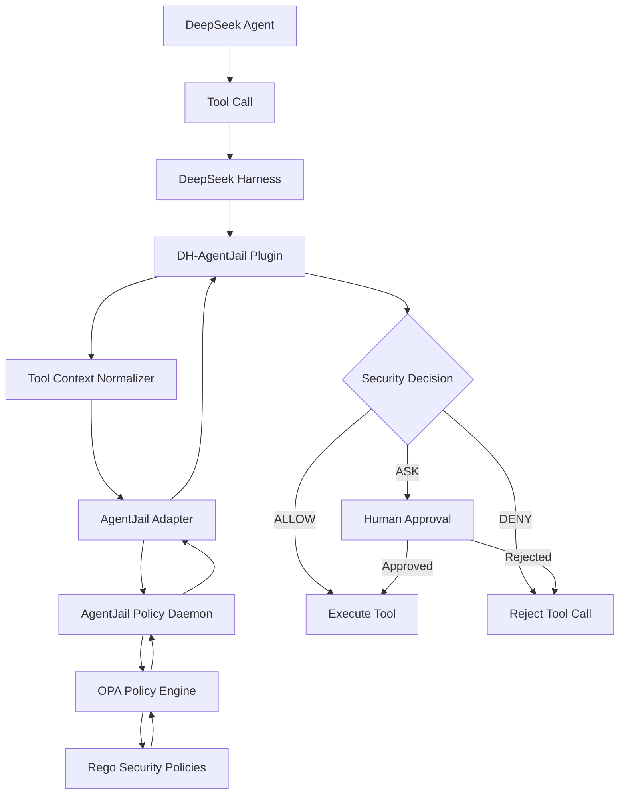
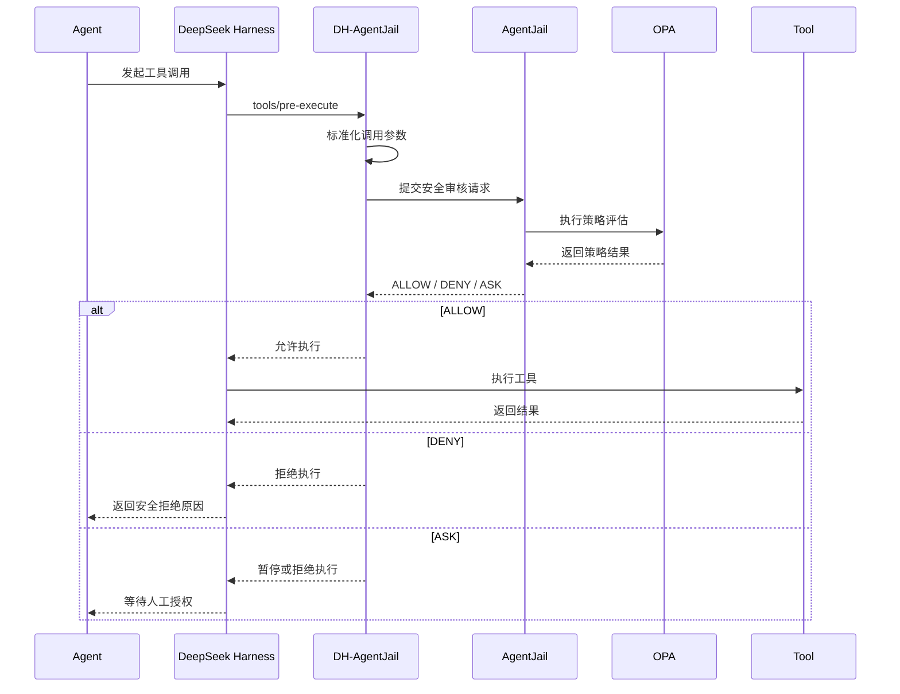

# DeepSeek Harness AgentJail Security Plugin
## AI Agent 工具调用安全审计与策略拦截插件项目白皮书

**项目代号：** DH-AgentJail  
**项目类型：** DeepSeek Harness 安全扩展插件  
**项目定位：** AI Agent Tool Security Gateway  
**核心依赖：** [AgentJail](https://github.com/LuD1161/agentjail)  
**技术框架：** DeepSeek Harness / Cordis / TypeScript / Go / OPA / Rego  
**文档版本：** v0.1  
**文档日期：** 2026 年 11 月

---

# 一、项目概述

## 1.1 项目背景

随着大语言模型（LLM）和 AI Agent 技术的发展，Agent 已经从单纯的文本生成系统逐渐演变为能够自主调用工具、访问文件系统、执行 Shell 命令、访问网络服务以及操作外部系统的自动化执行主体。

DeepSeek Harness 为 AI Agent 提供了工具注册、任务调度、执行管理和插件扩展等基础能力，使 Agent 能够通过工具调用完成复杂任务。

然而，Agent 获得工具执行能力的同时，也引入了新的安全风险：

- Prompt Injection：恶意指令诱导 Agent 执行非预期操作。
- 工具越权：Agent 调用超出当前任务授权范围的工具。
- 敏感信息泄露：Agent 读取或传输密钥、Token、配置文件等敏感信息。
- 危险命令执行：Agent 执行删除文件、修改系统配置、关闭安全防护等危险操作。
- 恶意网络访问：Agent 访问未授权域名、内部网络或外部恶意服务。
- 工具参数攻击：通过精心构造的工具参数绕过常规权限控制。

传统的工具权限机制通常关注工具是否可用，而不是每一次具体调用是否安全。

因此，需要在 Agent 工具执行链路中引入一个独立的安全审计机制，对每次工具调用进行实时判断，并在真正执行之前拦截不安全操作。

## 1.2 项目目标

本项目计划开发一个适用于 DeepSeek Harness 的安全审核插件，通过集成 AgentJail，为 Agent 的工具调用提供统一的安全策略检查和执行控制能力。

插件将作为工具执行前的安全防线，实现：

1. 自动捕获 Agent 发起的工具调用。
2. 提取工具名称、参数、执行上下文和资源信息。
3. 将调用请求提交给 AgentJail 安全策略引擎。
4. 根据策略引擎返回的结果决定是否允许执行。
5. 对不安全的工具调用直接拒绝。
6. 对需要人工授权的操作进行审批控制。
7. 记录安全审计日志，支持后续分析和追溯。

项目的核心原则是：

**任何工具调用都必须经过安全策略审核，未经授权的操作不得进入实际执行阶段。**

## 1.3 项目定位

DH-AgentJail 并不重新开发一套完整的安全策略引擎，而是将 DeepSeek Harness 的原生工具执行拦截机制与 AgentJail 的安全策略能力连接起来。

通过这种方式，实现：

- Harness 负责工具调用拦截和执行控制。
- DH-AgentJail 负责安全检查请求的适配和决策传递。
- AgentJail 负责安全策略计算和策略管理。
- OPA / Rego 负责底层策略规则执行。
- 操作系统级 Sandbox 提供更深层的执行隔离能力。

---

# 二、总体架构设计

## 2.1 系统架构

系统采用分层架构，将 Agent 运行环境、安全插件和策略引擎进行解耦。



## 2.2 核心模块

### 模块一：Harness Hook Interceptor

负责接入 DeepSeek Harness 的工具执行生命周期。

使用 Harness 原生插件扩展机制，监听：

`tools/pre-execute`

该事件发生在工具实际执行之前，插件可以检查工具调用，并通过返回拒绝决策阻止工具执行。

核心职责：

- 拦截所有纳入安全治理范围的工具调用。
- 获取工具执行上下文。
- 将执行请求交给安全审核模块。
- 根据审核结果返回允许或拒绝决策。

该模块不直接修改 Agent Loop，也不需要修改 DeepSeek Harness 核心代码。

### 模块二：Tool Context Normalizer

负责将 Harness 的工具执行对象转换为统一的安全审核请求。

建议标准化字段：

| 字段 | 说明 |
|---|---|
| request_id | 本次调用唯一标识 |
| session_id | Agent 会话标识 |
| tool_name | 工具名称 |
| tool_arguments | 工具调用参数 |
| agent_id | Agent 标识 |
| working_directory | 工作目录 |
| execution_time | 调用时间 |
| policy_context | 策略评估上下文 |

标准化模块需要注意：

- 对参数进行结构化处理。
- 对敏感字段进行脱敏。
- 限制请求体大小。
- 防止特殊字符和编码绕过。
- 不允许 Agent 自行声明可信身份或提高自身权限。

### 模块三：AgentJail Adapter

这是整个项目最关键的集成模块。

负责将 DeepSeek Harness 的工具执行请求转换为 AgentJail 能够理解的安全审核请求。

主要职责：

1. 与 AgentJail 策略服务建立通信。
2. 传递工具名称和执行参数。
3. 获取策略评估结果。
4. 将策略结果转换为 Harness 的执行决策。
5. 处理超时、异常和策略服务不可用等情况。

建议采用独立 Adapter 接口，避免插件与 AgentJail 内部实现产生强耦合。

优先复用 AgentJail 已有的策略检查及 Daemon 通信机制。如果现有接口无法直接支持 Harness 的通用 ToolExecution 对象，则增加一个稳定的本地适配协议。

不建议在每次工具调用时重新启动 AgentJail CLI 进程。

### 模块四：Security Decision Engine

负责将 AgentJail 的策略结果映射为 Harness 的执行决策。

统一采用三种决策：

| 决策 | 含义 | 执行行为 |
|---|---|---|
| ALLOW | 安全且符合策略 | 允许执行 |
| DENY | 不安全或明确禁止 | 拒绝执行 |
| ASK | 需要额外授权 | 暂停并请求审批 |

具体策略映射：

- ALLOW：返回 Harness 的继续执行决策。
- DENY：返回 Harness 的拒绝决策，并附带原因。
- ASK：进入人工审批流程；未经批准不得执行。

需要注意，ASK 不能简单地等同于 ALLOW。审批结果必须与原始调用绑定，防止修改参数后复用审批结果。

### 模块五：Audit Logger

记录每一次安全审核行为。

建议记录：

- 调用时间。
- Session ID。
- Tool Name。
- 工具参数摘要。
- 策略名称。
- 最终审核结果。
- 拒绝原因。
- 审批状态。
- 策略版本。
- 安全引擎响应时间。

默认采用本地日志存储，避免将敏感调用参数发送到外部服务。

---

# 三、AgentJail 集成方案

## 3.1 AgentJail 项目介绍

本项目选用 [LuD1161/agentjail](https://github.com/LuD1161/agentjail) 作为底层安全策略引擎。

AgentJail 是一个面向 AI Coding Agent 的安全防护项目，支持对 Claude Code、Codex 和 Cursor 等 Agent 的工具调用进行策略检查。

其主要技术能力包括：

- Tool Hooks：在工具执行前进行安全检查。
- OPA Policy Engine：通过 Open Policy Agent 执行策略判断。
- Rego Policies：使用 Rego 编写可配置安全规则。
- Allow / Ask / Deny：提供允许、人工确认和拒绝三种策略结果。
- Policy Daemon：通过本地常驻服务处理策略请求。
- Audit Logging：记录安全决策和执行事件。
- OS Sandbox：提供额外的操作系统级隔离能力。

AgentJail 已经具备本项目需要的核心安全策略能力，因此可以减少重复开发。

## 3.2 集成原则

本项目遵循以下原则：

**原则一：复用而不是重写。**

尽可能使用 AgentJail 已有的策略规则、OPA 引擎和策略管理能力。

**原则二：保持执行链路独立。**

DeepSeek Harness 负责 Agent 运行，AgentJail 负责安全判断，插件负责连接两者。

**原则三：安全决策优先。**

发生无法确认的情况时，不应默认允许执行。

**原则四：最小化侵入。**

不修改 Harness 核心代码，使用官方插件机制完成集成。

## 3.3 集成通信设计

建议在插件内部定义统一接口：

```typescript
export type SecurityVerdict =
  | {
      action: "allow";
      reason?: string;
    }
  | {
      action: "deny";
      reason: string;
      ruleId?: string;
    }
  | {
      action: "ask";
      reason: string;
      approvalId?: string;
    };

export interface AgentJailClient {
  evaluate(
    request: SecurityRequest
  ): Promise<SecurityVerdict>;
}

export interface SecurityRequest {
  requestId: string;
  sessionId?: string;
  toolName: string;
  arguments: Record<string, unknown>;
  workingDirectory?: string;
}
```

以上是插件侧建议定义的接口，不代表 AgentJail 已经提供完全相同的公开 API。

实际集成时，需要根据 AgentJail 当前版本的源码，确认 Daemon 的请求协议、身份认证方式、策略输入结构和响应格式。

推荐的通信方式：

第一阶段：
- 优先使用 AgentJail 已有的本地 Hook / Daemon 通信能力。
- 如果现有协议无法承载 Harness 的调用上下文，增加独立的 Adapter。

后续阶段：
- 提供稳定的本地 IPC 接口。
- 支持请求超时和取消。
- 支持 Daemon 健康检查。
- 支持策略版本识别。
- 支持并发调用。

建议避免直接依赖 AgentJail 的内部数据库结构或未承诺稳定的内部函数。

### 3.3.1 实测结论：为什么必须常驻守护进程

设计阶段曾评估过「不常驻守护进程，改为插件按需拉起一个短命进程、用 stdin/stdout 通信」的方案。对锁定版本 `v1.8.2` 的二进制实测后，该方案不可行，结论记录在此以免重复论证。

实测事实（通过运行二进制得到，非阅读上游源码）：

| 事实 | 证据 |
|---|---|
| release 包含两个可执行文件 | `agentjail`（41 MB）与 `agentjail-hook`（6.7 MB） |
| 策略引擎只编译进 `agentjail` | `agentjail-hook` 内 OPA/Rego 相关符号仅 31 处，`agentjail` 约 6747 处 |
| `agentjail-hook` 是单次转发的 stdin/stdout 层 | 喂入一行 hook JSON，输出一行判定 JSON，随后退出 |
| `agentjail-hook` 在连不上守护进程时 **fail-open（放行）** | 无守护进程时 `rm -rf /` 返回 `permissionDecision: allow` |
| 上游自述这是攻击面 | 二进制内嵌原文："agentjail-hook FAILS OPEN: if it cannot reach the daemon socket it ALLOWS the call … A prompt-injected or adversarial agent can abuse this by killing the daemon and slipping a command through the fail-open window" |
| `try --json` 支持 JSONL stdin/stdout，但**仍要求守护进程在线** | 无守护进程时返回 `{"action":"error","error":"daemon not reachable …"}` |
| 守护进程只监听 Unix domain socket，无 stdio 传输 | `--socket stdio` 不进入 stdio 模式 |
| 唯一的无守护进程路径是离线降级，仅保留 3 条自保护规则 | `hook-fallback.json` 仅含 `file_policy/agentjail_self`、`file_policy/agentjail_secrets`、`command_policy/no-policy-mutation`，其余策略关闭，且未命中时仍放行 |

因此：

1. **引擎只能经守护进程访问。** 任何「一次性进程内评估」都缺少引擎本体。
2. **无守护进程的路径全部 fail-open 或退化为固定子集。** 本插件是安全控制，5.2 要求 Fail-Closed；建在 fail-open 路径上会与本项目的安全方向相反——攻击者杀掉守护进程即可让命令穿过。
3. **每次工具调用重启 CLI 会重复编译 Rego bundle 并重读策略 overlay**，与 7.1 的 P95 < 50 ms 目标冲突。

**结论：继续采用守护进程模型。** 若上游未来提供「离线、fail-closed 的一次性评估入口」，可重新评估。向上游提出该需求的草稿见 `docs/UPSTREAM-OFFLINE-EVAL.md`。

### 3.3.2 vendoring 必须包含两个二进制

上游 release 同时提供 `agentjail` 与 `agentjail-hook`。本插件自身只通过 socket 与守护进程通信，不使用 `agentjail-hook`；但上游 CLI 的 `install` 流程会在 `agentjail` 同级目录查找 `agentjail-hook`，缺失时直接失败：

```
✗ agentjail install: daemon preamble: locate agentjail-hook: agentjail-hook not found next to the agentjail binary or in PATH
```

因此 `scripts/vendor-agentjail.mjs` 复制并 `chmod` 两个二进制，`vendor:check` 与 CI 打包检查也各自断言两者都存在。

## 3.4 Harness 原生插件接入

DeepSeek Harness 使用 Cordis 插件机制，支持通过 `tools/pre-execute` 实现原生工具执行拦截。

插件核心逻辑可以采用以下设计：

```typescript
import type { Context } from "@deepseek-ai/cordis";
import type {
  PreToolDecision,
  ToolExecution
} from "@deepseek-ai/dsh-tools";

export const name = "dh-agentjail";

export function apply(ctx: Context) {
  ctx.on(
    "tools/pre-execute",
    async (exec, next): Promise<PreToolDecision> => {

      const verdict = await agentJailClient.evaluate({
        requestId: createRequestId(),
        toolName: exec.toolName,
        arguments: normalizeArguments(exec)
      });

      if (verdict.action === "deny") {
        return {
          kind: "deny",
          reason: verdict.reason
        };
      }

      if (verdict.action === "ask") {
        return {
          kind: "deny",
          reason: "Human approval required: " +
            verdict.reason
        };
      }

      return next();
    }
  );
}
```

说明：

这是核心流程示意代码，具体字段名称、参数提取方式和审批接口需要依据实际 Harness 版本及类型定义完成适配。

其中 ASK 在第一阶段暂时采用拒绝执行的安全降级方式。后续接入真正的人工审批流程后，再实现完整的授权恢复机制。

---

# 四、安全策略设计

## 4.1 安全检查范围

插件需要覆盖以下几类安全风险。

### 4.1.1 文件系统安全

重点检查：

- 读取 SSH 私钥。
- 读取云服务凭证。
- 读取环境变量文件。
- 读取浏览器 Cookie。
- 访问系统敏感目录。
- 修改系统关键配置。
- 删除重要文件。
- 越权访问工作目录以外的文件。

典型示例：

```text
Tool: Read
Arguments:
  file_path: ~/.ssh/id_rsa

Decision: DENY
Reason: Sensitive credential access is prohibited.
```

### 4.1.2 Shell 命令安全

重点检查：

- 危险删除命令。
- Shell 动态执行。
- Base64 解码执行。
- 权限提升操作。
- 系统服务修改。
- 安全策略关闭。
- 未授权脚本执行。
- 危险 Git 操作。

典型示例：

```text
Tool: Bash
Arguments:
  command: rm -rf /

Decision: DENY
Reason: Destructive filesystem operation.
```

### 4.1.3 网络访问安全

重点检查：

- 未授权外部域名。
- 内部网络访问。
- 云 Metadata 地址。
- 可疑网络请求。
- 凭证外传。
- 未授权端口访问。

需要注意：仅在工具执行前检查参数，并不能完整覆盖命令执行后产生的网络连接。网络访问治理需要进一步使用 AgentJail 的 Network Tunnel / Netproxy 能力。

### 4.1.4 MCP 工具安全

重点检查：

- 未授权 MCP Server。
- 未授权 MCP Tool。
- 高风险工具调用。
- 参数中包含敏感数据。
- 跨服务的数据传输。
- 超出当前会话授权范围的操作。

### 4.1.5 权限与系统安全

重点检查：

- 用户权限修改。
- 系统安全配置修改。
- 进程管理。
- 后台任务创建。
- 定时任务创建。
- 安全防护机制关闭。

## 4.2 策略决策模型

建议使用默认拒绝、显式授权的安全模型。

| 风险等级 | 处理方式 | 示例 |
|---|---|---|
| LOW | ALLOW | 读取普通项目文件 |
| MEDIUM | ASK | 修改项目配置 |
| HIGH | DENY / ASK | 访问敏感文件、外部数据传输 |
| CRITICAL | DENY | 读取私钥、破坏系统安全配置 |

风险等级与最终决策并非简单的一一对应关系，最终结果应以策略规则为准。

例如，用户明确授权的某些高风险操作可以进入 ASK 流程，而被锁定的禁止规则不能被普通用户或 Agent 覆盖。

## 4.3 安全策略配置

建议沿用 AgentJail 的 Policy-as-Code 模式。

策略示例：

```yaml
# 示例：DH-AgentJail 策略配置

enforcement: enforce

security:
  default_action: deny
  timeout_action: deny
  daemon_unavailable_action: deny

  filesystem:
    deny_sensitive_files: true
    deny_ssh_private_keys: true
    deny_cloud_credentials: true

  shell:
    block_destructive_commands: true
    block_shell_eval: true
    block_privilege_escalation: true

  network:
    require_tunnel_for_network_policy: true
    deny_untrusted_destinations: true

  mcp:
    require_registered_server: true
    default_action: deny

audit:
  enabled: true
  storage: local
  redact_sensitive_data: true
```

上述 YAML 是 DH-AgentJail 的配置设计示例，不应直接视为 AgentJail 当前支持的配置格式。正式实现应将对应配置映射到 AgentJail 已有的 `policy.yaml` 和 Rego 规则体系，避免出现两套相互冲突的策略来源。

---

# 五、核心执行流程

## 5.1 工具调用安全审计流程



## 5.2 审核失败处理

安全插件必须考虑安全引擎不可用的情况。

例如：

- AgentJail Daemon 未启动。
- IPC 连接失败。
- 策略计算超时。
- 策略文件损坏。
- 返回结果格式异常。
- 审核请求无法完成。

默认采用 Fail-Closed 策略：

**只要无法获得可信、明确的 ALLOW 结果，就不执行受保护的工具调用。**

同时需要注意，AgentJail 当前存在不同保护层级，Hook 检查和操作系统 Sandbox 并不是同一个安全边界。插件必须明确展示实际生效状态，不能仅因为 Hook 已安装，就宣称整个 Agent 执行环境已经受到完整隔离。

---

# 六、项目功能规划

## 6.1 第一阶段：基础安全拦截 MVP

目标：实现 DeepSeek Harness 与 AgentJail 的基础集成。

功能：

1. 开发 DH-AgentJail 插件。
2. 注册 `tools/pre-execute` 监听器。
3. 实现 ToolExecution 参数标准化。
4. 实现 AgentJail Adapter。
5. 实现安全审核请求。
6. 实现 ALLOW / DENY 决策映射。
7. 实现 Fail-Closed 机制。
8. 实现基础安全审计日志。

验收标准：

- 能够捕获受保护范围内的工具调用。
- 安全工具调用正常执行。
- 危险工具调用被成功拒绝。
- AgentJail 不可用时不会默认放行。
- 拒绝原因能够返回给 Agent。
- 能够通过测试验证工具没有实际执行。

## 6.2 第二阶段：完整策略支持

目标：复用 AgentJail 更完整的安全策略能力。

功能：

1. 集成文件访问策略。
2. 集成 Shell 命令策略。
3. 集成 MCP 工具策略。
4. 集成敏感凭证保护。
5. 支持 ASK 决策。
6. 支持策略热更新。
7. 支持按 Agent / Session / Tool 设置策略。
8. 支持策略审计和历史查询。

## 6.3 第三阶段：人工审批与执行隔离

目标：构建更完善的 Agent 安全控制体系。

功能：

1. 开发人工审批接口。
2. 实现一次性授权。
3. 实现会话级授权。
4. 实现授权过期和撤销。
5. 集成 AgentJail OS Sandbox。
6. 集成网络访问控制。
7. 实现安全状态检测。
8. 实现完整审计追踪。

审批授权必须绑定具体的工具、参数、Session、执行身份和策略版本，避免授权被重放或用于其他操作。

## 6.4 第四阶段：企业级安全治理

目标：面向多 Agent、多用户和企业级部署。

功能：

- 统一安全策略管理。
- 多 Agent 安全隔离。
- 策略模板管理。
- 风险统计与分析。
- 安全事件告警。
- 策略变更审计。
- 企业级权限管理。
- 安全策略分发。
- 安全报告生成。

---

# 七、非功能性需求

## 7.1 性能要求

安全审核不应该明显影响 Agent 的正常运行。

建议初期性能目标：

| 指标 | 目标 |
|---|---|
| 安全检查方式 | 本地优先 |
| Daemon 模式 | 常驻服务 |
| 额外进程启动 | 每次工具调用不启动新进程 |
| 审核延迟 | P95 小于 50ms |
| 并发能力 | 支持并发工具审核 |
| 请求超时 | 可配置 |
| 服务异常 | Fail-Closed |

性能指标为项目设计目标，并非 AgentJail 已经对 DeepSeek Harness 集成做出的性能承诺。正式验收应在目标操作系统和真实工具负载下测量。

## 7.2 可靠性要求

- 插件初始化失败时，应明确报告安全保护未就绪。
- 策略服务断开时，拒绝受保护调用。
- 策略更新失败时，继续使用最后一份经过验证的策略，或者进入拒绝模式。
- 不允许因日志服务异常而绕过安全检查。
- 不允许将未知策略结果转换为 ALLOW。

## 7.3 隐私要求

- 默认本地完成策略审核。
- 敏感参数不得明文写入普通日志。
- 不向外部服务发送工具调用内容。
- 审计日志采用最小化记录原则。
- 支持日志保留期限和清理策略。

---

# 八、安全边界与风险分析

本项目需要明确：工具调用拦截并不等同于完整的运行环境安全隔离。

仅监听 `tools/pre-execute`，无法自动覆盖所有可能发生的副作用。

例如：

1. 已授权的 Shell 命令可能启动其他进程。
2. 某个工具内部可能执行未经审核的文件操作。
3. 工具执行期间可能产生网络连接。
4. 恶意 MCP Server 可能在自身内部执行额外操作。
5. Agent 可能通过未纳入拦截范围的其他执行入口绕过插件。

因此，需要采用纵深防御：

| 安全层 | 负责内容 |
|---|---|
| Harness Hook | 工具调用前置拦截 |
| AgentJail Policy | 策略评估 |
| OPA / Rego | 安全规则执行 |
| OS Sandbox | 文件系统和进程执行隔离 |
| Network Proxy | 网络访问控制 |
| Audit Logger | 安全事件追踪 |

其中，OS Sandbox 和 Network Proxy 应作为后续增强能力逐步集成。

不能将插件级拦截描述为能够防御所有 Prompt Injection 或所有恶意工具行为。

---

# 九、技术选型

| 组件 | 技术方案 | 作用 |
|---|---|---|
| Agent Runtime | DeepSeek Harness | Agent 运行环境 |
| Plugin Framework | Cordis | 插件生命周期管理 |
| Plugin Language | TypeScript | 插件实现 |
| Security Adapter | TypeScript | 安全协议适配 |
| Security Engine | AgentJail | 安全策略执行 |
| Policy Engine | OPA | 策略评估 |
| Policy Language | Rego | 安全策略编写 |
| Sandbox | AgentJail Shield | 操作系统级隔离 |
| IPC | AgentJail 现有本地通信机制 | 安全请求传递 |
| Audit | AgentJail 本地审计机制及插件审计记录 | 审计追踪 |

---

# 十、项目目录结构建议

建议将插件作为独立 TypeScript 项目开发。

```text
dh-agentjail/
│
├── package.json
├── tsconfig.json
├── README.md
├── LICENSE
│
├── src/
│   ├── index.ts
│   │
│   ├── hooks/
│   │   └── pre-tool-execute.ts
│   │
│   ├── adapter/
│   │   ├── agentjail-client.ts
│   │   ├── protocol.ts
│   │   └── connection.ts
│   │
│   ├── security/
│   │   ├── decision.ts
│   │   ├── normalizer.ts
│   │   ├── sanitizer.ts
│   │   └── approval.ts
│   │
│   ├── audit/
│   │   └── logger.ts
│   │
│   ├── config/
│   │   └── schema.ts
│   │
│   └── utils/
│       ├── errors.ts
│       └── request-id.ts
│
├── tests/
│   ├── interceptor.test.ts
│   ├── adapter.test.ts
│   ├── security.test.ts
│   └── integration.test.ts
│
├── docs/
│   ├── ARCHITECTURE.md
│   ├── SECURITY.md
│   └── INTEGRATION.md
│
└── examples/
    └── cordis.patch.yml
```

该目录为建议结构，实际项目可以根据 Harness 的插件包规范进行调整。

---

# 十一、测试与验收方案

## 11.1 功能测试

覆盖：

- 普通文件读取。
- 敏感文件读取。
- 普通 Shell 命令。
- 危险 Shell 命令。
- 未授权 MCP 工具。
- 授权 MCP 工具。
- 策略服务不可用。
- 审核超时。
- 策略返回异常。
- 审批被拒绝。
- 审批过期。

## 11.2 安全测试

重点验证：

1. 不安全工具调用是否在执行前被阻断。
2. 工具参数修改是否能够绕过规则。
3. 路径遍历是否能够绕过文件访问限制。
4. Shell 混淆和命令组合是否能够绕过危险命令检测。
5. Agent 是否能够通过其他工具入口绕过审核。
6. 是否存在审批重放。
7. 策略服务失效时是否会错误放行。
8. 日志是否泄露敏感参数。

## 11.3 核心验收条件

<project-acceptance>
- [ ] Harness 插件能够正常加载和卸载。
- [ ] 工具执行前能够触发安全审核。
- [ ] AgentJail 能够正确评估审核请求。
- [ ] ALLOW 能够正常放行。
- [ ] DENY 能够阻止工具执行。
- [ ] ASK 在未经授权时不能执行。
- [ ] AgentJail 服务不可用时拒绝受保护调用。
- [ ] 安全审计记录完整。
- [ ] 不修改 Harness 核心代码。
- [ ] 通过集成测试和安全回归测试。
</project-acceptance>

---

# 十二、开源与项目交付规划

建议项目以独立开源插件形式发布，保持与 AgentJail 的松耦合关系。

初期交付内容：

1. DH-AgentJail 插件源代码。
2. AgentJail 集成适配器。
3. Harness 插件安装说明。
4. 默认安全策略模板。
5. 安全策略配置说明。
6. 单元测试和集成测试。
7. Docker 或本地开发环境。
8. 项目架构文档。

建议优先采用 Apache-2.0 许可证，但正式发布前需要确认 AgentJail 及所有实际复用代码的许可证兼容性，并保留必要的第三方版权和许可证声明。

---

# 十三、项目实施路线图

| 阶段 | 主要工作 | 交付成果 |
|---|---|---|
| Phase 1 | 技术调研与接口验证 | AgentJail 集成原型 |
| Phase 2 | Harness Hook 开发 | 工具调用拦截插件 |
| Phase 3 | AgentJail Adapter 开发 | 策略审核能力 |
| Phase 4 | 审核决策与日志 | 基础安全防护版本 |
| Phase 5 | ASK 与审批机制 | 人工授权版本 |
| Phase 6 | Sandbox 集成 | 纵深防御版本 |
| Phase 7 | 安全测试与发布 | v1.0 正式版本 |

---

# 十四、项目预期成果

项目完成后，将形成一套适用于 DeepSeek Harness 的 Agent 工具调用安全防护机制。

预期实现以下能力：

**1. 工具调用透明审核**

Agent 发起工具调用时，无需修改 Agent 本身的提示词或业务逻辑，即可在 Harness 执行链路中进行安全检查。

**2. 安全策略复用**

直接复用 AgentJail 的安全策略和 OPA / Rego 能力，减少重复开发。

**3. 危险操作主动拦截**

对于读取敏感文件、执行危险命令、访问未授权资源等行为，在工具执行之前拒绝。

**4. 人工授权控制**

对需要额外授权的行为，提供 ASK 和审批机制，避免将所有风险操作简单地归类为允许或禁止。

**5. 可审计、可追溯**

完整记录安全决策，便于安全事件分析和策略优化。

**6. 可扩展的安全架构**

未来可以继续集成 Sandbox、网络代理、MCP 安全管理和企业级策略治理能力。

---

# 十五、总结

随着 AI Agent 从信息处理工具逐渐发展为能够直接操作计算机和外部系统的执行主体，安全问题已经成为 Agent 基础设施建设中不可忽视的一部分。

本项目通过将 AgentJail 集成到 DeepSeek Harness 的工具执行生命周期中，构建一个独立、可扩展、可配置的安全审核插件。

项目不试图重新实现底层安全策略，而是利用 Harness 的原生拦截能力与 AgentJail 已有的安全策略引擎，建立统一的工具调用安全控制机制。

其最终目标是：

**让每一次 Agent 工具调用都经过安全审查，让未经授权的操作无法执行，让 AI Agent 的能力始终运行在明确、可控、可审计的安全边界之内。**

